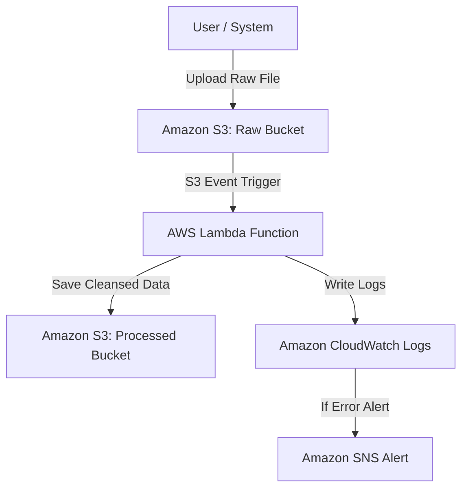

# ĐỀ XUẤT GIẢI PHÁP WORKSHOP: XÂY DỰNG SERVERLESS DATA PIPELINE TỰ ĐỘNG BẰNG AWS SERVICES

---

### Phần 1: Tổng quan bài toán & Giải pháp 
Trong kỷ nguyên Điện toán đám mây và Dữ liệu lớn (Big Data), việc xử lý và làm sạch dữ liệu đầu vào tự động đóng vai trò cốt lõi trong hoạt động vận hành của doanh nghiệp. Bài toán đặt ra là xây dựng một hệ thống xử lý dữ liệu tự động, có tính sẵn sàng cao, bảo mật và tối ưu chi phí mà không cần quản lý máy chủ vật lý hay hạ tầng phức tạp.

**Giải pháp đề xuất:** Xây dựng một **Serverless Data Pipeline** trên nền tảng Amazon Web Services (AWS). Hệ thống sẽ tự động kích hoạt xử lý dữ liệu ngay khi người dùng hoặc hệ thống đẩy file dữ liệu thô (Raw CSV/JSON) lên lưu trữ, sau đó làm sạch, chuẩn hóa và lưu dữ liệu đã xử lý vào bộ lưu trữ đích đồng thời ghi nhật ký hoạt động.

---

### Phần 2: Mục tiêu & Phạm vi 

#### Mục tiêu
- Xây dựng thành công quy trình xử lý dữ liệu tự động sử dụng kiến trúc **Serverless & Event-Driven**.
- Áp dụng nghiêm ngặt nguyên tắc **Least Privilege** của bộ trụ cột Bảo mật (Security Pillar) trong khung chuẩn AWS Well-Architected.
- Đo lường, giám sát toàn bộ luồng xử lý dữ liệu thông qua hệ thống log và cảnh báo tự động.
- Viết tài liệu hướng dẫn kỹ thuật từng bước (Step-by-step Lab Guide) đảm bảo tính tái lập (Reproducible) cho cộng đồng.

#### Phạm vi dự án
- **Trong phạm vi:**
  - Khởi tạo và cấu hình 2 Amazon S3 Buckets (`raw-data-bucket` và `processed-data-bucket`).
  - Cấu hình IAM Roles và Policies với quyền hạn tối thiểu cho AWS Lambda.
  - Phát triển hàm AWS Lambda (Python/Node.js) xử lý và làm sạch dữ liệu từ S3.
  - Cấu hình Amazon S3 Event Notification để kích hoạt Lambda tự động.
  - Tích hợp Amazon CloudWatch Logs và thiết lập CloudWatch Alarms gửi cảnh báo qua Amazon SNS khi xử lý lỗi.
  - Xây dựng bảng dự toán chi phí chi tiết bằng **AWS Pricing Calculator** và viết quy trình dọn dẹp tài nguyên (Clean-up).
- **Ngoài phạm vi:**
  - Triển khai mô hình Machine Learning chuyên sâu trên dữ liệu.
  - Xây dựng giao diện Frontend phức tạp cho người dùng cuối.

---

### Phần 3: Vấn đề cần giải quyết 

1. **Thao tác thủ công & Trễ thời gian:** Quy trình xử lý dữ liệu truyền thống phụ thuộc vào lịch chạy định kỳ (Cron Jobs) hoặc thao tác con người, gây ra độ trễ lớn và dễ phát sinh lỗi thao tác.
2. **Lãng phí chi phí hạ tầng:** Việc duy trì máy chủ EC2 hoạt động 24/7 để chờ xử lý dữ liệu gây lãng phí chi phí lớn khi lưu lượng dữ liệu biến động không đều.
3. **Rủi ro an toàn thông tin:** Cấu hình phân quyền quá rộng (Over-privileged IAM policies) dễ dẫn đến lộ tài nguyên hoặc rò rỉ dữ liệu nhạy cảm.
4. **Thiếu khả năng quan sát:** Không có cơ chế tập trung để theo dõi log, cảnh báo sự cố tức thì khi tiến trình xử lý bị đứt gãy.

---

### Phần 4: Kế hoạch & Timeline thực hiện 

Dự án được chia thành các giai đoạn thực hiện từ **Tuần 1 đến Tuần 12**:

| Tuần | Nội dung công việc | Đầu ra dự kiến |
| :---: | :--- | :--- |
| **Tuần 1 - 2** | Nghiên cứu AWS CLI, khởi tạo tài khoản, tạo S3 Buckets cho dữ liệu thô và dữ liệu chuẩn hóa. | Tài khoản AWS chuẩn bị xong, 2 S3 Buckets hoạt động. |
| **Tuần 3 - 4** | Thiết lập IAM Roles, Policies phân quyền Least Privilege giữa Lambda, S3 và CloudWatch. | IAM Roles được khởi tạo với chính sách bảo mật chặt chẽ. |
| **Tuần 5 - 6** | Viết code xử lý dữ liệu cho AWS Lambda và cấu hình S3 Event Notification. | Mã nguồn Lambda hoàn chỉnh, sự kiện tự động kích hoạt thành công. |
| **Tuần 7 - 8** | Tích hợp Amazon CloudWatch Logs, cấu hình Metrics và Amazon SNS Alarms. | Hệ thống ghi log và cảnh báo tự động khi phát sinh lỗi. |
| **Tuần 9 - 10** | Kiểm thử toàn bộ hệ thống (End-to-End Testing), tối ưu hóa hiệu năng và bộ nhớ Lambda. | Báo cáo kiểm thử, hệ thống vận hành ổn định. |
| **Tuần 11 - 12** | Hoàn thiện tài liệu Workshop kỹ thuật song ngữ, dự toán chi phí, tạo video/link Demo và dọn dẹp tài nguyên. | Website Workshop hoàn chỉnh công khai trên GitHub Pages. |  

---

### Phần 5: Bảng dự toán ngân sách & Chi ph

Dựa trên công cụ **AWS Pricing Calculator** với giả định lưu lượng xử lý 10,000 file dữ liệu/tháng:

| Dịch vụ AWS | Mức sử dụng ước tính | Chi phí hàng tháng (USD) |
| :--- | :--- | :---: |
| **Amazon S3** | 5 GB Storage (Standard Class) + 10,000 PUT/GET Requests | $0.00 (Nằm trong Free Tier) / ~$0.15 |
| **AWS Lambda** | 10,000 lượt chạy (Duration ~500ms, Memory 128MB) | $0.00 (Miễn phí 1M requests/tháng) |
| **Amazon CloudWatch** | 1 GB Log Ingestion + 1 Alarm | $0.00 (Nằm trong Free Tier) / ~$0.50 |
| **Amazon SNS** | < 1,000 thông báo Email/tháng | $0.00 (Miễn phí 1,000 Email) |
| **Tổng chi phí ước tính** | **Khoảng $0.00 / tháng (Áp dụng AWS Free Tier)** | **~$0.65 / tháng (Nếu hết Free Tier)** |

> ⚠️ **Lưu ý:** Hệ thống được thiết kế tối ưu trên hạ tầng Serverless nên chi phí tiệm cận 0 USD đối với quy mô thử nghiệm.

---

### Phần 6: Rủi ro & Phương án giảm thiểu 

| Rủi ro tiềm ẩn | Mức độ | Phương án giảm thiểu |
| :--- | :---: | :--- |
| **Vượt ngân sách AWS (Cost Overrun)** | Trung bình | - Thiết lập AWS Budgets và nhận email cảnh báo khi chi phí vượt quá $1. - Tạo quy trình dọn dẹp tài nguyên (Clean-up Guide) ngay sau khi thử nghiệm. |
| **Rò rỉ thông tin xác thực (Security Leak)** | Cao | - Không hard-code Access Key/Secret Key trong mã nguồn GitHub. - Áp dụng IAM Least Privilege và bật MFA cho tài khoản AWS. |
| **Lỗi vòng lặp vô tận (Infinite Loop Event)** | Cao | - Tránh việc Lambda ghi trực tiếp file mới vào cùng S3 Raw Bucket đã dùng để kích hoạt sự kiện. |
| **Lỗi định dạng dữ liệu đầu vào (Invalid Data Format)** | Thấp | - Bổ sung khối try-catch trong code Lambda để xử lý ngoại lệ và đẩy log lỗi lên CloudWatch. |
---

### Phần 7: Kiến trúc giải pháp sơ bộ 

Kiến trúc hệ thống bao gồm các thành phần chính:

---

### Tài liệu tham khảo 

- [AWS Well-Architected Framework](https://aws.amazon.com/architecture/well-architected/)
- [Amazon S3 Developer Guide](https://docs.aws.amazon.com/s3/)
- [AWS Lambda Developer Guide](https://docs.aws.amazon.com/lambda/)
- [AWS Pricing Calculator](https://calculator.aws/)
- [Quy định về Workshop - HCM Rules FCAJ](https://hcm-rules.awsfcaj.com/3-project/#23-proposal-đề-xuất-giải-pháp-workshop)

